**I build web products, simulations and motion.** 
Institution software, virtual labs and films made in code.

Integrated B.Tech + M.Tech, IT · ABV-IIITM Gwalior · Gwalior, India

[dhananjaypvt.me](https://dhananjaypvt.me) · [LinkedIn](https://linkedin.com/in/dhananjay-agrawal-b5843b211) · [Email](mailto:dhananjayworkmain@gmail.com)

 

| Project | |
| --- | --- |
| **[PhysicsSimulation](https://physicssimulation.org)** | 160 browser labs in physics, chemistry, maths and biology. |
| **Coaching Platform** | Enquiries, batches, attendance, fees and tests for a coaching institute. |
| **Smart Attendance** | Biometric attendance with WhatsApp alerts to parents. |
| **[Arogyani](https://www.arogyani.in/)** | OPD software for clinics with a live token queue. |
| **[Sher-e-Darbar](https://www.sheredarbar.com/)** | Hindi and English restaurant site with a scroll-driven 3D opening. |
| **[INKPLAY](https://inkplay-lemon.vercel.app)** | Draw a level on paper, play it as a platformer. |
| **Films** | Launch reels and explainers rendered from code with HyperFrames. |

Most of this ships from private repositories.

 

INTERFACE 
&nbsp;&nbsp;
&nbsp;&nbsp;
&nbsp;&nbsp;
&nbsp;&nbsp;
&nbsp;&nbsp;

MOTION AND 3D 
&nbsp;&nbsp;
&nbsp;&nbsp;
&nbsp;&nbsp;
&nbsp;&nbsp;

SERVER AND DATA 
&nbsp;&nbsp;
&nbsp;&nbsp;
&nbsp;&nbsp;
&nbsp;&nbsp;
&nbsp;&nbsp;
&nbsp;&nbsp;
&nbsp;&nbsp;

BEYOND THE BROWSER 
&nbsp;&nbsp;
&nbsp;&nbsp;
&nbsp;&nbsp;
&nbsp;&nbsp;

SHIPPING 
&nbsp;&nbsp;
&nbsp;&nbsp;
&nbsp;&nbsp;
&nbsp;&nbsp;
&nbsp;&nbsp;

 

Drawn by <a href="scripts/contributions.mjs">a script in this repo</a>, refreshed daily.

 

Open to full-time roles and freelance work. 
**[dhananjayworkmain@gmail.com](mailto:dhananjayworkmain@gmail.com)**
