&nbsp;

**Dhananjay Agrawal**

I build web products, simulations and motion: institution software, virtual labs and films made in code.

Integrated B.Tech + M.Tech in IT at ABV-IIITM Gwalior.

[dhananjaypvt.me](https://dhananjaypvt.me) &nbsp; [LinkedIn](https://linkedin.com/in/dhananjay-agrawal-b5843b211) &nbsp; [dhananjayworkmain@gmail.com](mailto:dhananjayworkmain@gmail.com)

 

 

| Project | |
| --- | --- |
|  **[PhysicsSimulation](https://physicssimulation.org)** | 160 browser labs in physics, chemistry, maths and biology. |
|  **Coaching Platform** | Enquiries, batches, attendance, fees and tests for a coaching institute. |
|  **Smart Attendance** | Biometric attendance with WhatsApp alerts to parents. |
|  **[Arogyani](https://www.arogyani.in/)** | OPD software for clinics with a live token queue. |
|  **[Sher-e-Darbar](https://www.sheredarbar.com/)** | Hindi and English restaurant site with a scroll-driven 3D opening. |
|  **[INKPLAY](https://inkplay-lemon.vercel.app)** | Draw a level on paper, play it as a platformer. |
|  **Films** | Launch reels and explainers rendered from code with HyperFrames. |

Most of this ships from private repositories.

 

<table>
<tr><td width="200"><b>Interface</b></td><td width="680">&nbsp;&nbsp;&nbsp;&nbsp;&nbsp;&nbsp;<picture><source media="(prefers-color-scheme: dark)" srcset="https://cdn.simpleicons.org/nextdotjs/ece6da"></picture>&nbsp;&nbsp;&nbsp;&nbsp;&nbsp;&nbsp;<picture><source media="(prefers-color-scheme: dark)" srcset="https://cdn.simpleicons.org/radixui/ece6da"></picture></td></tr>
<tr><td width="200"><b>Motion and 3D</b></td><td width="680"><picture><source media="(prefers-color-scheme: dark)" srcset="https://cdn.simpleicons.org/threedotjs/ece6da"></picture>&nbsp;&nbsp;&nbsp;<picture><source media="(prefers-color-scheme: dark)" srcset="https://cdn.simpleicons.org/webgl/ece6da"></picture>&nbsp;&nbsp;&nbsp;&nbsp;&nbsp;&nbsp;<picture><source media="(prefers-color-scheme: dark)" srcset="https://cdn.simpleicons.org/framer/ece6da"></picture>&nbsp;&nbsp;&nbsp;<picture><source media="(prefers-color-scheme: dark)" srcset="https://cdn.simpleicons.org/ffmpeg/ece6da"></picture></td></tr>
<tr><td width="200"><b>Server and data</b></td><td width="680">&nbsp;&nbsp;&nbsp;<picture><source media="(prefers-color-scheme: dark)" srcset="https://cdn.simpleicons.org/express/ece6da"></picture>&nbsp;&nbsp;&nbsp;<picture><source media="(prefers-color-scheme: dark)" srcset="https://cdn.simpleicons.org/socketdotio/ece6da"></picture>&nbsp;&nbsp;&nbsp;&nbsp;&nbsp;&nbsp;&nbsp;&nbsp;&nbsp;<picture><source media="(prefers-color-scheme: dark)" srcset="https://cdn.simpleicons.org/prisma/ece6da"></picture>&nbsp;&nbsp;&nbsp;&nbsp;&nbsp;&nbsp;</td></tr>
<tr><td width="200"><b>Beyond the browser</b></td><td width="680">&nbsp;&nbsp;&nbsp;<picture><source media="(prefers-color-scheme: dark)" srcset="https://cdn.simpleicons.org/razorpay/ece6da"></picture>&nbsp;&nbsp;&nbsp;&nbsp;&nbsp;&nbsp;<picture><source media="(prefers-color-scheme: dark)" srcset="https://cdn.simpleicons.org/expo/ece6da"></picture>&nbsp;&nbsp;&nbsp;</td></tr>
<tr><td width="200"><b>Shipping</b></td><td width="680">&nbsp;&nbsp;&nbsp;&nbsp;&nbsp;&nbsp;&nbsp;&nbsp;&nbsp;&nbsp;&nbsp;&nbsp;<picture><source media="(prefers-color-scheme: dark)" srcset="https://cdn.simpleicons.org/vercel/ece6da"></picture>&nbsp;&nbsp;&nbsp;</td></tr>
</table>

 

 

Open to full-time roles and freelance work. 
**[dhananjayworkmain@gmail.com](mailto:dhananjayworkmain@gmail.com)**
